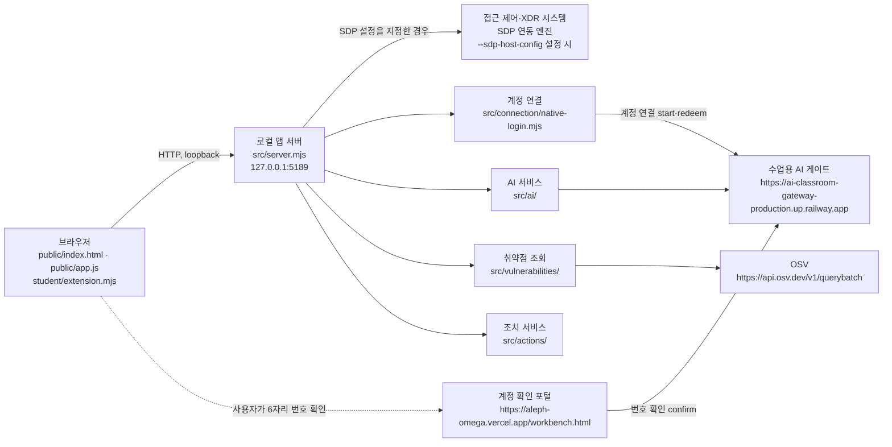

# 케셰브 학생용 실행 설명서 및 시스템 구성도

기록 기준일: 2026-10-23. 이 문서는 실행 위치·실행 절차·구성 요소와 `student/extension.mjs`의 학생 화면 경계를 설명합니다. 제공 문서는 수정하지 않았습니다. 아래에서 **PC에서 확인한 기록**, **코드상 계약**, **미확인**을 구분합니다. 이 문서를 작성하며 PowerShell 명령이나 실제 서비스 요청을 실행한 것은 아닙니다.

## 1. 목적과 기능 범위

케셰브는 학생 프로젝트의 브라우저 화면에서 로그인·기기·세션 상태, 업무 앱 접근 판정, 접속 기록과 XDR 경보, 연결 점검, AI 설명·조치 상태, 설치 패키지 취약점 조회 결과를 표시하는 로컬 보안 Agent입니다. 기본 실행은 기존 접근 제어·XDR 시스템에 연결되지 않은 상태입니다. `-Demo`는 예제 자료를 표시하며 실제 연결이 아닙니다.

이 저장소에서 학생이 고치는 대상은 `on-client/student/extension.mjs`입니다. 이 문서 작성 단계에서는 코드나 화면을 변경하지 않았습니다. 제공된 브라우저 UI, 서버, 실행 도구 및 기타 모듈은 학생 작성 기능과 구분해 유지합니다.

## 2. PC에서 확인한 실행 환경과 프로젝트 위치

| 항목 | 기록 |
|---|---|
| 확인한 PC 환경 | Windows 11 Pro, Windows PowerShell 5.1, Node.js v24.19.0, Git 2.55 — **확인함 (2026-10-23, 해당 PC)** |
| 시작 틀 | `alekov-client-starter` 버전 `0.2.14` — **확인함**. `package.json`의 Node 엔진 기준은 `24.19.0`입니다. |
| Node 버전 주의 | 이 PC에서 실제 확인한 것은 v24.19.0입니다. 시작 스크립트는 Node 22~24를 허용하고 그 외 버전에는 안내를 표시하지만, 이 프로젝트의 다른 버전·운영체제 동작은 **미확인**입니다. |
| 의존성 설치 | `on-client`에는 외부 npm 의존성이 없고 `package-lock.json`이 없어 `npm install`이 필요하지 않음 — **확인함**. |
| 실제 작업 위치 | 워크벤치 프로젝트 폴더 안의 `on-client`. 예: `C:\Users\<사용자>\AppData\Local\ALEPH\Workbench\projects\choi-vault\on-client` — **확인함**. `<사용자>`와 프로젝트 폴더명은 본인 PC의 실제 경로로 읽습니다. |
| Git 저장소 | `ginye28/choi-bujang-secret-vault` 저장소에 같은 `on-client` 폴더가 포함됨 — **확인함**. 저장소 최상위 시험 경로는 `test/on-client/*.test.mjs`입니다. |
| 설정 견본 `.env.example` | 비밀값이 없는 견본이며 키 이름은 `ON_PORT`, `ON_ENGINE_ADAPTER`, `ON_AI_MODEL`, `ON_PROJECT_DIRECTORY`, `ON_APPROVED_PUBLIC_PACKAGES` — **확인함**. 기본 실행에는 `.env`가 필요 없고, 열쇠·토큰·비밀번호는 이 문서와 커밋에 적지 않습니다. |

문서의 실제 실행 위치는 저장소 최상위가 아니라 `on-client`입니다. 저장소 최상위 시험 명령과 앱 실행 명령은 서로 다른 작업 위치에서 실행합니다.

## 3. 실행·브라우저·종료·재실행

### 기본 실행

1. 파일 탐색기에서 본인 워크벤치 프로젝트의 `on-client` 폴더를 엽니다.
2. 그 폴더에서 PowerShell을 엽니다. 예를 들어 파일 탐색기 주소 표시줄에 `powershell`을 입력하고 Enter를 누릅니다. 작업 위치가 `on-client`인지 확인합니다.
3. 다음 명령을 실행합니다.

```powershell
powershell -NoProfile -ExecutionPolicy Bypass -File .\tools\start-alekov.ps1
```

`-ExecutionPolicy Bypass`는 이 한 번의 실행에만 적용됩니다. 컴퓨터의 실행 정책을 변경하지 않습니다. `start-alekov.ps1`은 Node 버전·앱 폴더·포트를 확인하고 서버를 시작합니다. 기본 실행에서는 계정 연결 준비도 수행합니다. `package.json`의 `npm start`는 `node src/server.mjs`를 실행하지만, 이 계정 연결 설정 자동 준비 절차를 수행하지 않습니다. 이 프로젝트는 외부 npm 의존성이 없으므로 `npm install` 단계가 없습니다.

### 정상 시작 신호와 주소

기본 시작에서 확인한 출력 순서는 다음과 같습니다 — **확인함 (2026-10-23, 해당 PC)**.

```text
계정 연결 준비가 끝났습니다. 앱에서 확인 번호로 로그인·승인을 진행하세요.
케셰브가 켜졌습니다. 브라우저에서 http://127.0.0.1:5189/ 을 여세요.
서버가 응답한 것만 확인했습니다. AI 연결 상태는 화면에서 따로 확인해 주세요.
```

그 뒤 브라우저에서 `http://127.0.0.1:5189/`을 엽니다. 서버 응답은 서버가 켜졌다는 확인일 뿐, AI·계정·SDP 연결 성공을 뜻하지 않습니다.

예제 모드는 다음과 같이 실행합니다.

```powershell
powershell -NoProfile -ExecutionPolicy Bypass -File .\tools\start-alekov.ps1 -Demo -Port 5190
```

예제 화면 주소는 `http://127.0.0.1:5190/`이며, 화면 머리에는 `예제 데이터(demo) · 실제 연결 아님`이 표시됩니다 — **확인함**. 예제는 실제 연결이 아닙니다.

추가 선택 방법:

- 포트 5189가 사용 중이면 기존 프로그램을 종료하지 말고 `-Port 5190`을 붙입니다. 주소도 `http://127.0.0.1:5190/`로 바꿉니다.
- 창 없이 실행하려면 기본 명령 끝에 `-Background`를 붙입니다. `뒤에서 실행 중입니다(프로세스 번호 N)` 안내에서 프로세스 번호를 확인합니다.
- 기본 실행 창은 실행 중 그대로 둡니다. 종료할 때 해당 PowerShell 창에서 `Ctrl+C`를 누릅니다.
- `-Background` 실행은 작업 관리자에서 안내된 프로세스 번호의 `node`를 종료합니다.
- 재실행은 같은 `on-client` 폴더에서 같은 시작 명령을 다시 실행하는 것입니다. 자동 계정 연결 설정은 `%USERPROFILE%\.aleph-keshev-<프로젝트 해시>\native.json`에 다시 씁니다. 기록된 설정에는 비밀값이 없습니다. 해당 경로는 프로젝트 폴더 밖입니다. 설정 파일 내용을 출력하거나 문서에 복사하지 않습니다.

### 시험 명령

저장소 최상위 폴더에서 다음 명령을 실행합니다. 이 명령은 앱 실행 명령이 아닙니다.

```powershell
node --test test/on-client/*.test.mjs
```

2026-10-23에 기록된 결과는 46개 통과이며, 모의 DOM 시험으로 실제 브라우저 시험은 아닙니다 — **확인함**. 이 문서 작성 시점에 시험을 다시 실행하지 않았습니다.

## 4. 시스템 구성도와 데이터 흐름



- 브라우저는 `public/index.html`, `public/app.js`와 학생 모듈 `student/extension.mjs`를 사용하고, `src/server.mjs`가 제공하는 로컬 HTTP API에 요청합니다. 서버는 loopback 주소에서 동작합니다.
- 접근 제어·XDR은 `--sdp-host-config`를 지정할 때 사용하는 SDP 연동 엔진 경로입니다. 현재 기록된 실행은 미연결입니다. 일반 시작 출력만으로 SDP를 확인한 것이 아닙니다.
- 계정 연결은 `src/connection/native-login.mjs`가 수업용 AI 게이트에 연결 요청(start)·결과 확인(redeem)을 보내고, 사용자는 앱의 「계정 확인 페이지 열기」로 포털을 열어 6자리 번호를 확인(confirm)합니다. 계정 확인 포털 주소는 공개 주소만 표기했습니다. AI 관련 코드는 `src/ai/`에 있고 수업용 AI 게이트 주소와 연결됩니다.
- 취약점 조회 코드는 `src/vulnerabilities/`에 있으며 OSV 공개 API 주소를 사용합니다.
- `src/actions/`는 조치 서비스를 구성하는 코드 경계입니다. 현재 기록에서는 지원 조치가 없고 실제 조치 집행은 **미확인**입니다.
- 이 도식은 모듈과 설정에 따른 흐름을 설명합니다. 실제 계정 승인·AI 통신·SDP 연결·조치 성공을 나타내지 않습니다. 비공개 설정값이나 자격 증명은 포함하지 않았습니다.

## 5. 학생 함수·입력 계약·제공 코드 경계

아래는 코드에서 읽은 학생 함수와 `public/app.js`가 전달하는 자료의 개요입니다. **코드 계약 대조이며, 이 문서 작성 중 브라우저 실행으로 검증한 것이 아닙니다.** API 상태 문자열과 화면의 `data-student-*` 속성은 현재 계약을 유지합니다.

| 단계·함수 | 입력 개요와 표시 책임 | 경계 |
|---|---|---|
| 13 `renderIdentity` | `me`, `devices`, `sessions` 자료의 상태·모드와 사용자, 기기, 세션 목록 | 로그인·기기·세션 자료를 그리는 학생 함수 |
| 14 `renderDecision` | 판정 요청의 `status`, `mode`, `appId`, 성공 `data` 또는 `error`; `allow`, `deny`, `challenge`, `unknown`을 구분 | 서버 판정 표시이며 실제 업무 앱 접속을 보장하지 않음 |
| 15 `renderEvents` | `status`, `mode`, 기록 배열 `data`, `error`; 기록에는 `id`, `kind`, `at`, `appId`, `summary`, `evidence`, `rules`, `state`, `supportedActions` 등이 있음 | 기록의 필터·상세 표시. 새 요청이나 조치 집행 함수가 아님 |
| 16 `renderStatus` | 연결 모드, 기기·세션 자료, `notifications`, `diagnostics` | 상태·오류·빈 결과 안내 및 도움정보 화면 |
| 17 `renderAiConnection` | AI 점검의 `status`, `mode`, 성공 `data` 또는 오류 `error` | AI 연결 점검 상태 표시. 점검 성공과 사건 설명 성공은 별개 |
| 17·18 `renderExplanation` | 선택 사건 `event`, `explanation.status`, 설명 `data` 또는 `error`, 확인 시각 | 사건 근거를 대조해 설명 표시. 기록을 바꾸거나 조치를 집행하지 않음 |
| 19 `renderAction` | `status`, `event`, `actionId`, `target`, `receipt`, `observation`, 오류 등 현재 조치 자료 | 서버가 제공한 조치 상태 표시. 함수 자체가 조치를 요청하거나 집행하지 않음 |
| 20 `renderVulnerabilities` | 조회 `status`, `mode`, 취약점 조회 `data` 또는 `error` | 조회·미조회·일부 실패·확인 불가 상태를 구분 |
| 진입점 `createStudentView` | 호출 시 위 8개 렌더 함수를 반환 | 학생 모듈의 공개 함수 집합 |

`public/app.js`는 화면 골격, 버튼 동작, API 호출, 계약 검사 및 학생 모듈 로드를 담당하는 제공 코드입니다. `src/server.mjs`와 `src/`, `public/`, `tools/`, `vendor/` 아래 구현도 제공 코드입니다. 이번 작업은 문서만 새로 작성했으며 이 경계를 변경하지 않았습니다.

## 6. PC에서 확인한 기능과 미확인 동작

아래의 실행·화면 결과는 2026-10-23 해당 PC에서 기록된 사실입니다. 모의 시험 결과와 실제 화면 관찰을 실제 서비스 연결 검증으로 확대 해석하지 않습니다.

| 확인 항목 | 기록 |
|---|---|
| 일반 미연결 실행 화면 | 연결 없는 실행에서 각 칸이 `연결 없음(disconnected)` 및 `ENGINE_NOT_CONNECTED`로 표시됨 — **확인함** |
| 설치 패키지 조회 | `설치 패키지 조회` 결과가 `not_configured (PROJECT_NOT_CONFIGURED)`이고 허용 목록이 비어 있어 정상 — **확인함**. 취약점이 없다는 뜻은 아님 |
| 예제의 AI 설명 요청 | `AI 설명 요청` 시 `ON_AI_PROVISIONING_PENDING` 오류가 학생 칸에 사유와 함께 표시되고 기록 목록은 유지됨 — **확인함** |
| 조치 UI | `supportedActions`가 비어 조치 준비 버튼이 없음 — **확인함** |
| 시험 | 저장소 최상위에서 실행한 46개 모의 DOM 시험 통과 기록 — **확인함**. 실제 브라우저 시험 아님 |
| 계정 연결 | `계정 연결 시작` 후 포털 번호 확인에서 게이트가 HTTP 401 `ON_APP_NATIVE_SESSION_UNVERIFIED`를 반환함. 계정 연결 성공으로 보지 않음 — **확인함** |
| AI 앱 승인, 「현재 API 연결 점검」 | 위 401 때문에 확인하지 못함 — **미확인** |
| 실제 사건 설명, 실제 조치 집행, SDP 연결 | 실제 시스템 연결 및 동작을 확인하지 못함 — **미확인** |
| 실제 PC 브라우저를 통한 이번 실행·시험 재실행 | 이 문서 작성 중 수행하지 않음 — **미확인** |

## 7. 오류별 확인 순서와 복구

오류 코드는 그대로 유지합니다. 오류 상세 절차는 제공 문서 [CONNECTION_TROUBLESHOOT.md](CONNECTION_TROUBLESHOOT.md)의 해당 항목을 따릅니다. 아래는 현재 실행·관찰과 맞춘 우선 확인 순서입니다.

| 순서·상태 | 의미와 확인 방법 | 복구·다음 단계 |
|---|---|---|
| 포트 사용 중 (`포트 5189 를 다른 프로그램이 쓰고 있습니다`) | 기본 포트를 다른 프로그램이 사용 중입니다. 그 프로그램은 종료하지 않습니다. | 같은 `on-client`에서 시작 명령에 `-Port 5190`을 추가하고 브라우저를 `http://127.0.0.1:5190/`으로 엽니다. |
| `NATIVE_HOST_BUSY` | 이전 계정 연결 작업이 남았을 수 있습니다. | 앱에서 계정 연결을 취소하거나 앱을 재실행한 뒤 계정 연결을 새로 시작합니다. |
| `NATIVE_HOST_EXPIRED` | 계정 연결 확인 기한이 지났습니다. | 기존 연결을 취소하거나 앱을 재실행한 뒤 새 계정 연결을 시작합니다. |
| `ENGINE_NOT_CONNECTED` | 기본 실행에 접근 제어·XDR 엔진이 연결되지 않았습니다. | 이를 성공으로 취급하지 않습니다. SDP 설정이 제공된 경우에만 담당자 지침에 맞춰 `-SdpHostConfig` 경로를 사용합니다. 현재 SDP 실제 연결은 미확인입니다. |
| `ON_AI_PROVISIONING_PENDING` | 학생 앱 계정 연결 또는 앱 전용 AI 이용 권한이 준비되지 않았거나 확인되지 않았습니다. | 계정 연결·AI 앱 승인을 성공으로 가정하지 말고 담당자에게 현재 앱 권한과 게이트 반영을 확인합니다. 자동으로 재시도하지 않습니다. |
| `PROJECT_NOT_CONFIGURED` / `not_configured` | 설치 패키지 허용 목록이 비어 있어 조회 대상 프로젝트가 설정되지 않았습니다. 기록된 실행에서는 정상 상태였습니다. | 학생이 조회 경로나 허용 목록을 임의로 설정하지 않습니다. 조회 대상 준비 여부를 담당자에게 확인합니다. |
| 서버 시작 제한 시간 초과 | 시작 도구가 제한 시간 안에 서버 응답을 받지 못한 상태입니다. | 실행 창 메시지를 확인하고 [CONNECTION_TROUBLESHOOT.md](CONNECTION_TROUBLESHOOT.md)의 실행 도구 항목에 따라 담당자에게 문의합니다. 서버가 실제로 시작됐다고 단정하지 않습니다. |
| 그 밖의 확인 불가·연결 오류 | 오류 메시지와 API 코드가 정상 상태를 보장하지 않습니다. | 성공·빈 결과로 바꾸지 말고 오류 코드와 함께 제공된 문제 해결 안내를 확인합니다. |

## 8. 사용자가 직접 진행할 확인

한 번에 한 단계씩 진행합니다. 기존 프로젝트 파일과 Git 기록을 유지하며, 실제 유료 AI 요청·보안 조치·단계 제출은 이 문서의 절차에 포함하지 않습니다.

1. **확인 1 — 실행 절차:** 새 PowerShell 창을 `on-client`에서 열고 3절의 기본 명령을 실행합니다. 위에 기록된 시작 신호가 나타나는지 확인하고 브라우저에서 기본 주소를 엽니다. 실행하지 않았거나 신호가 다르면 성공으로 간주하지 않습니다.
2. **확인 2 — 문서 대조:** 실행 주소·버튼 이름·화면 상태를 프로젝트의 `tools/start-alekov.ps1`, `public/app.js`, `student/extension.mjs`와 대조합니다. 실제로 보지 못한 항목은 **미확인**으로 둡니다.

이 서버는 문서에 적힌 명령을 대신 실행하지 않습니다. 이 설명서의 과거 PC 확인 기록은 새 PC에서 실행한 결과를 대신하지 않습니다.
